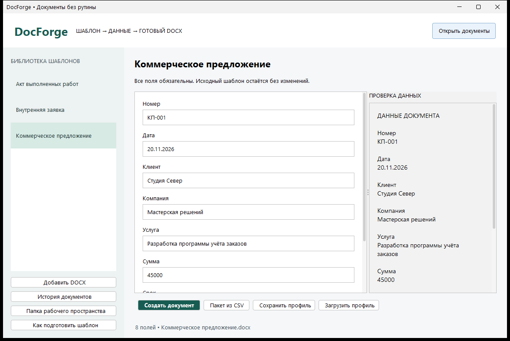

# DocForge

[Русский](README.md)

An offline desktop DOCX template filler for quotations, completion certificates and internal requests. Fill a generated form or create a batch from CSV.



## Features

- Import templates containing `{{Field name}}` placeholders; forms are built automatically.
- Replace fields in paragraphs, tables, nested tables, headers and footers, including placeholders split across Word runs.
- Keep surrounding formatting and apply the first placeholder run's styling to the replacement.
- Save field profiles, validate required fields and browse generated document history.
- Batch UTF-8 CSV with comma/semicolon delimiters, quoted values and multiline cells.
- Validate every CSV record before generation; report individual file failures.
- Preserve templates and refuse to overwrite existing output files.
- Three example templates and a two-record demonstration CSV with fictional data.

## Quick start

Build with JDK 21+ and Maven 3.9+:

```sh
mvn clean verify
java -jar target/docforge-1.0.0.jar
```

Windows users can use `build.cmd` and `run.cmd`. Running the JAR requires Java 21. Releases also provide a Windows ZIP with a bundled runtime: extract it and launch `DocForge.exe`. The application interface is Russian.

Choose a template, fill its fields and click the green generation button. Open the output folder from the header. To batch-generate, select the provided CSV from the workspace.

## Templates and storage

Use `{{Name}}` in Word. Names accept letters, numbers, spaces, underscores, hyphens and periods. CSV headings must match field names exactly; all discovered fields are required. Extra CSV columns are ignored.

The default workspace is `%LOCALAPPDATA%\DocForge` on Windows and `~/DocForge` elsewhere. It contains `templates/`, `profiles/`, `output/`, `history.tsv` and a sample CSV. Override it with `--workspace <directory>`.

```sh
java -jar target/docforge-1.0.0.jar --workspace target/demo --demo
```

This command creates two real DOCX documents without displaying the UI. `--screenshot docs/screenshot.png` captures the displayed application and exits.

## Validation

`mvn verify` exercises real DOCX replacement across formatting runs, table/header substitution, repeated placeholders, missing fields, overwrite prevention, profiles/history, quoted CSV and malformed input. The CI template in `ci/build.yml` builds the runnable JAR and runs the batch demo. Automatic CI is not enabled: move it to `.github/workflows/build.yml` using credentials with workflow permissions.

## Limitations

The preview is a field summary, not a paginated Word renderer. PDF conversion, formulas, repeating item rows, shape text boxes, footnotes and protected documents are unsupported. Fields are designed for single-line values; CSV newlines remain XML text and their display depends on the document editor. Review generated files before use. Templates are examples and can be edited in Word. Workspace data is not encrypted. Separate application instances do not coordinate history writes or output-name allocation.

## Structure

Java 21, Swing, FlatLaf, Apache POI, JUnit 5 and Maven. `DocumentEngine` handles DOCX; `Csv` validates input; `Workspace` manages local files; `App` supplies the desktop UI and background generation.

## Author and license

Nikita, [Fr1bilder](https://github.com/Fr1bilder), `nikitazadan89@yandex.ru`.

Project code is [MIT licensed](LICENSE). Bundled dependencies retain their own licenses and notices in the JAR's `META-INF` directory.
