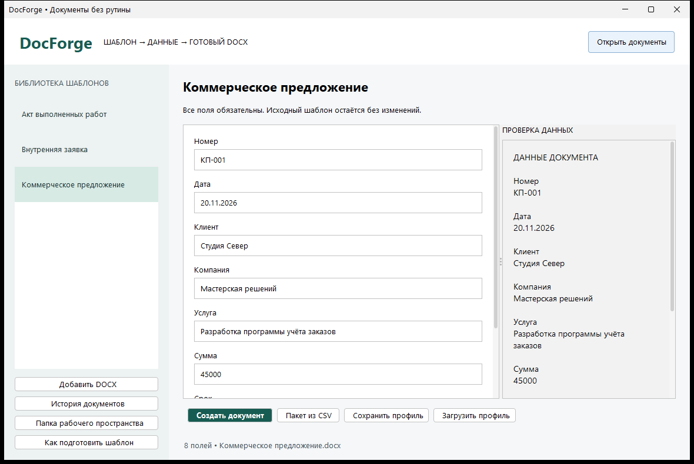

# DocForge

[English](README.en.md)

Настольная программа, которая заполняет DOCX-шаблоны данными из формы или CSV. Подходит для коммерческих предложений, актов и внутренних заявок. Работает локально, без аккаунта и подписки.



## Возможности

- Библиотека собственных DOCX-шаблонов и три примера при первом запуске.
- Автоматическое построение формы по полям `{{Клиент}}`, `{{Дата}}`, `{{Номер}}`.
- Подстановка в текст, таблицы, вложенные таблицы и колонтитулы, включая поля, разделённые Word на несколько фрагментов форматирования.
- Сохранение форматирования окружающего текста. Значение получает оформление начала поля.
- Профили реквизитов, проверка обязательных полей, история и открытие созданных файлов.
- Пакет из CSV: UTF-8, разделитель `,` или `;`, кавычки и многострочные значения.
- Проверка всего CSV перед началом генерации. Ошибки отдельных файлов отражаются в результате пакета.
- Исходники не изменяются. Существующие документы не перезаписываются.

## Быстрый старт

Требования для сборки: JDK 21+, Maven 3.9+.

```powershell
mvn clean verify
java -jar target/docforge-1.0.0.jar
```

В Windows также доступны `build.cmd` и `run.cmd`. Для запуска собранного JAR достаточно Java 21. В релизах есть Windows-пакет со встроенной Java: распакуйте ZIP и откройте `DocForge.exe`.

1. Выберите «Коммерческое предложение».
2. Замените демонстрационные данные в форме.
3. Нажмите «Создать документ», затем «Открыть документы».
4. Для пакета выберите `Пример-пакет.csv` в рабочем пространстве.

Своё поле в Word: `{{Название поля}}`. Разрешены буквы, цифры, пробелы, `_`, `-`, `.`. В CSV заголовки должны точно совпадать с именами полей, без внешних пробелов. Все обнаруженные поля обязательны. Дополнительные столбцы CSV игнорируются.

## Хранение данных

По умолчанию `%LOCALAPPDATA%\DocForge`, в других ОС `~/DocForge`:

```text
templates/        исходные DOCX
profiles/         сохранённые значения полей
output/           готовые документы
history.tsv       журнал генерации
Пример-пакет.csv  вымышленные демонстрационные данные
```

Другой каталог можно выбрать при запуске:

```powershell
java -jar target/docforge-1.0.0.jar --workspace "D:\Documents\DocForge"
java -jar target/docforge-1.0.0.jar --workspace target/demo --demo
```

`--demo` создаёт два реальных документа из примера CSV без открытия интерфейса. `--screenshot docs/screenshot.png` открывает интерфейс, сохраняет его снимок и завершает приложение.

## Проверка

`mvn verify` проверяет замену полей между фрагментами Word, оформление, таблицы и колонтитулы, повторные поля, защиту от перезаписи, профили, историю, CSV с кавычками и ошибочные входные данные. Шаблон GitHub Actions находится в `ci/build.yml`: он собирает JAR и выполняет демонстрационный пакет. Для включения перенесите файл в `.github/workflows/build.yml` с GitHub-доступом к workflows; автоматический запуск пока не включён.

## Ограничения

Панель проверки показывает значения подстановок, а не постраничное отображение Word. PDF, формулы, повторяемые строки товарной таблицы, текстовые блоки внутри фигур, сноски и защищённые документы не поддерживаются. Значения рассчитаны на однострочные поля; переносы из CSV сохраняются в XML-тексте, но их отображение зависит от редактора. Откройте итоговый DOCX для проверки перед отправкой. Встроенные шаблоны демонстрационные, их содержание можно изменить в Word. Данные и профили хранятся без шифрования. При одновременной работе нескольких экземпляров журнал и выбор имени файла не синхронизируются между процессами.

## Структура и стек

Java 21, Swing, FlatLaf, Apache POI, JUnit 5, Maven.

- `DocumentEngine.java`: обнаружение и подстановка полей.
- `Csv.java`: чтение CSV с проверкой структуры.
- `Workspace.java`: шаблоны, профили, история и выходные файлы.
- `App.java`: интерфейс и фоновая генерация.
- `src/test/`: тесты на настоящих DOCX и файловых каталогах.

## Автор и лицензия

Никита, [Fr1bilder](https://github.com/Fr1bilder), `nikitazadan89@yandex.ru`.

Код проекта: [MIT](LICENSE). Зависимости распространяются по собственным лицензиям; их уведомления находятся в `META-INF` собранного JAR.
